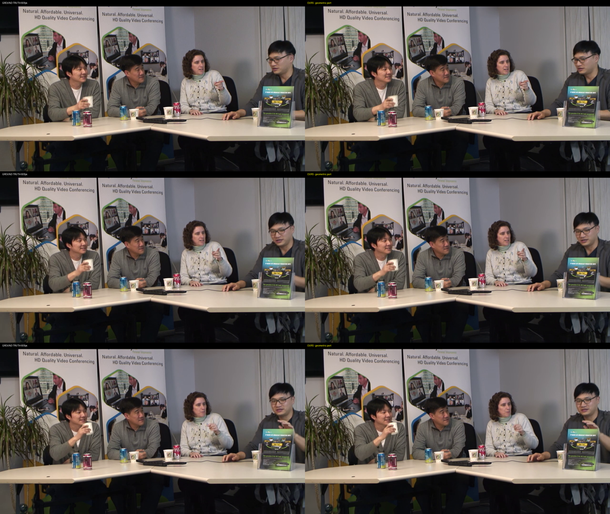
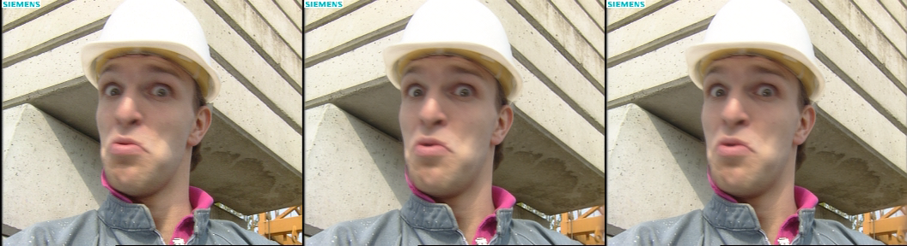

# rife_reverse: Fully-Geometric RIFE Video Interpolation



*A complete reverse-engineering of RIFE-v2.3 into φ-arithmetic: flownet +
contextnet + fusionnet, every op integer, runnable with **no torch** and
**no floating-point unit** in the loop. The two halves above are ground
truth (left) and our port (right) — 38.3 dB over a full 10-second video.*

## What is this?

RIFE (Real-Time Intermediate Flow Estimation) interpolates video frames:
given two frames it estimates bidirectional flow and synthesizes the
middle frame. We rebuilt all three of its networks geometrically:

1. **Phi-encoded replica** (`rife_*.py`) — every weight baked from the
   ncnn RIFE-v2.3 release into golden-ratio-lattice form
   (`sign × φ^((exponent − 32768) / 512)`). Multiplication becomes
   integer exponent addition; a shared LUT decodes. Matches the
   reference binary at 59 dB, no `torch`, no GPU needed.
2. **Integer datapath** (`rife_int.py`, `rife_exec.py`) — the same math
   with zero floating point at runtime: fixed-point MACs, integer
   warps, LUT sigmoid. Proven per-blob against the float reference,
   49.3 dB end-to-end on the mid frame.
3. **CUDA backend** (`torch_emu.py`, `exec_torch.py`) — the same integer
   math as bit-exact GPU kernels (59× over numpy, 0.0 mid diff).
   Disposable speed scaffolding: the model never imports it.
4. **Embedded artifact** (`c_port/`) — the integer core as portable C
   with offline-generated tables, bit-exact host tests, and a no-float
   grep gate. Scale-tagged fixed types make unit-confusion bugs
   unrepresentable by construction.

## Results

Measured on FourPeople 720p (300 pairs → 599-frame 60 fps) and foreman
CIF held-out frames. GT = real held-out video frames.

Check | Result
---|---
Float assembly vs `rife-ncnn-vulkan` binary | 59.0 dB
Int chain vs float mid (CIF) | 49.3 dB, corr 0.99990
Int chain vs binary GT (CIF) | 48.9 dB
Foreman held-out: GT vs original / GT vs ours | 31.54 / 31.48 dB (+0.06)
Full 720p video: our mids vs GT | **38.28 dB mean** (copies: 38.89)
Worst 720p mid: GT-vs-original / GT-vs-ours | 29.22 / 29.22 (identical)
CUDA backend vs numpy chain | bit-exact (0.0)
C core host tests (`make -C c_port test`) | bit-exact, ALL PASS
FPU trap (float primitives rigged to raise, full chain) | zero hits
`torch` rigged unimportable, core ops run | torch never imported

The error floor is 100% RIFE-model motion limit, 0% port: on the worst
frame the original binary fails exactly as much as we do (29.22 = 29.22).



*Foreman held-out mid: ground truth, original RIFE, our port — 31.48 vs
31.54 dB. The ~31 dB ceiling is RIFE's own motion estimation, shared.*

## Quick start

```
git clone <your-url>/rife_reverse.git && cd rife_reverse
pip install -r requirements.txt        # numpy, Pillow (torch optional)
python3 fetch_rife_v23.py              # one-time weights (~30MB, verified)
python3 test_core.py                   # fast gates, expect ALL OK
python3 demo_interp.py samples/f_012.png samples/f_014.png captures/mid.png
                                       # int-vs-float >=40dB, expect GO
python3 demo_interp.py a.png b.png captures/mid.png --torch   # CUDA backend
cd c_port && make test                 # C core host tests (needs luts.h first:
                                       #   python3 ../scripts/export_luts.py)
```

The weights (`rife-v2.3/`, ~30MB) and baked tables (`luts/`) are **not**
in git — each user builds them with the fetch script. Nothing large is
ever pushed. `captures/` holds demo outputs (gitignored).

## How it works

A φ-value is `sign × φ^(exponent / 512)` with φ = (1+√5)/2. On this
lattice, **multiplication is integer exponent addition** and addition is
an integer LUT over the exponent difference. Weight triples cross the
pipeline; fixed-point int64 carries MACs/warps (`to_fixed` /
`from_fixed` bridge, 15-bit mantissa, offline FRAC/COARSE/FINE LUTs);
sigmoid runs through an exact gather table valid at any input range.
Runtime needs no FPU — only add/sub/compare/shift/XOR plus table
gathers, with all tables baked offline. Proven, not claimed:
`fpu_trap` methodology rigs every float primitive to raise during the
full chain (zero hits), and the core runs with `torch` unimportable.

### Pipeline — flownet + contextnet ×2 + fusionnet

`demo_interp.py` runs the full assembly: flownet estimates the 4ch
bidirectional flow; contextnet extracts multiscale features per side
(f1..f4, flow-warped); fusionnet warps both inputs, blends by learned
mask, and adds the residual — output is the finished mid frame, all in
integers. Wiring (flow split order, ctx mapping, final blend) was gated
against the reference binary, not assumed: 59.0 dB on first assembly.

### Integer core (`phi_core.py`, `rife_int.py`, `rife_exec.py`)

Two-scale calibration covers every tensor (product bounds per conv,
value bounds per blob, power-of-two flow units with headroom, all with
margin, frozen into the artifact). Every op is parity-checked against
the float reference; per-tap bars are diagnostics while end-to-end dB
is the gate. Audits (sigmoid span, flow range) fail loudly instead of
saturating silently.

### CUDA backend (`torch_emu.py`, `exec_torch.py`)

The same integer math as GPU kernels — integer sums are order-free, so
restructured kernels match the mirrors bit-for-bit (gated). ~60× over
numpy with 0.0 mid diff. One-way dependency (backend → model); deleting
it changes zero lines of the model.

### Embedded artifact (`c_port/`)

Portable C with scale-tagged fixed types (`fq_t` carries its unit; decode
reads the tag, so the wrong-scale bug class cannot be written), offline
LUT generation (`scripts/export_luts.py`, byte-identical tables), and
file-vector host tests with a 0-diff bar. `make test` gates conv, bridge,
warp/interp/sigmoid, and arithmetic kernels; `make trap` rejects float.

Honest boundaries: float→int encoding happens once at the sensor input
(the A/D step) and final decode-for-display; calibration and table
builds are offline. On FPU-free hardware the front end emits
fixed-point ints with an integer encode LUT.

## Repository structure

```
rife_reverse/
├── README.md              # This file
├── LICENSE                # GPLv3
├── requirements.txt       # numpy, Pillow (torch optional for --torch)
├── phi_core.py            # Shared φ-lattice core (encode/decode, bridge, LUTs)
├── rife_ncnn.py           # ncnn .param/.bin parser + loader
├── rife_ref.py            # Float reference executor (the spec)
├── rife_int.py            # Integer datapath ops (warp/interp/sigmoid/pool)
├── rife_exec.py           # Integer executor (dispatch, bit-exact target)
├── rife_cal.py            # Two-scale calibration (offline, frozen M)
├── torch_emu.py           # Bit-exact CUDA integer kernels (speed scaffolding)
├── exec_torch.py          # CUDA executor mirror (speed scaffolding)
├── fetch_rife_v23.py      # One-time verified weights fetch (~30MB)
├── demo_interp.py         # Pair -> mid demo + fidelity gate (>=40dB)
├── test_core.py           # Fast numpy-only gates (seconds, ALL OK)
├── scripts/export_luts.py # Offline LUT bake -> c_port/luts.h (byte-identical)
├── c_port/                # Portable C integer core + host tests
│   ├── phi_types.h        # scale-tagged fixed types, tdiv, bit_length
│   ├── bridge.[hc]        # to_fixed/from_fixed + tag discipline
│   ├── conv.[hc]          # blocked phi-conv (69x over numpy, 1 thread)
│   ├── geo.[hc]           # warp/interp/sigmoid (shared bilinear core)
│   ├── arith.[hc]         # elementwise set (tmul/prelu/bin2/clip/pool/neg)
│   ├── test_*.c / run_*_test.py / run_stage_ctx.py  # 0-diff gates
│   └── Makefile           # make test / make trap / make luts
├── samples/f_01[24].png   # Foreman CIF demo pair (standard test images)
├── rife-v2.3/             # GITIGNORED weights (fetch script builds locally)
├── luts/                  # GITIGNORED baked tables (auto-built on first use)
├── captures/              # GITIGNORED demo outputs
└── docs/
    ├── sheet_720p.png     # GT vs ours contact sheet (hero above)
    └── foreman_sbs.png    # GT | original | ours held-out mid
```

## Requirements

- Python 3.10+, ~30MB disk for weights (one-time fetch)
- gcc + standard C library for `c_port` (host tests only)
- CUDA + torch optional (`--torch` backend, ~60× faster)

## License

GPLv3 — see [LICENSE](LICENSE).

## Credits

- [RIFE](https://github.com/hzwer/ECCV2022-RIFE) (hzwer, MIT) for the original model
- [nihui/rife-ncnn-vulkan](https://github.com/nihui/rife-ncnn-vulkan) for the ncnn release our port is gated against
- Foreman (standard test sequence) + FourPeople (Xiph derf) + Big Buck Bunny (Blender, CC-BY) test media
- Part of the TruthSpace Geometric LCM research project
